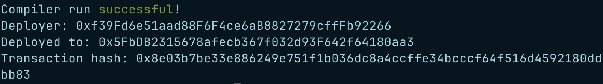
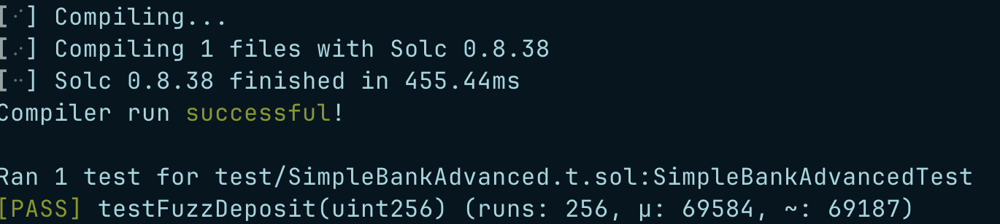

## 测试部署

使用三个工具进行编译运行：

- forge：负责编译、测试、部署合约

```bash
// 初始化项目
forge init lesson01

// 编译代码
forge build

// 执行自动化测试
forge test
```

- anvil：启动本地EVM区块链

```
// 创建一个默认测试链，10个带测试资金的开发账户
anvil
```

- cast：查询区块链、调用合约、发送交易

```
cast block-number --rpc-url http://127.0.0.1:8545
```


solidity编码

```solidity
// 合约声明，类
contract SimpleStorage {}

// 只读函数，不修改链上状态
// returns 声明返回类型
function retrieve() public view returns (uint256) {
    return favoriteNumber;
}
```

- 部署到本地链

```
// 设置环境变量
export RPC_URL=http://127.0.0.1:8545
export PRIVATE_KEY=0xac0974bec39a17e36ba4a6b4d238ff944bacb478cbed5efcae784d7bf4f2ff80
```


执行部署

```
forge create src/SimpleStorage.sol:SimpleStorage \
  --rpc-url $RPC_URL \
  --private-key $PRIVATE_KEY \
  --broadcast
```

查找链上数字

```
cast call $CONTRACT_ADDRESS \
  "retrieve()(uint256)" \
  --rpc-url $RPC_URL
```

修改链上的值

```
cast send $CONTRACT_ADDRESS \
  "store(uint256)" 100 \
  --rpc-url $RPC_URL \
  --private-key $PRIVATE_KEY
```

查找交易信息

```
cast tx 0x8e03b7be33e886249e751f1b036dc8a4ccffe34bcccf64f516d4592180ddbb83 --rpc-url http://127.0.0.1:8545
```



其中，Deployer为发起部署交易的地址；Deployed to 为创建的智能合约地址；Transaction hash 为部署交易的哈希

## 基础语法

- 常用数据类型

```
uint256
int256
bool
address			// 以太坊地址，表示用户账户/合约账户，不表示交易hash
string
```

- 函数状态

```
pure		// 不能读取，也不能修改区块链上的合约状态
view 		// 只能读取，不能修改区块链的合约状态

// 构造函数，msg.sender表示当前调用的直接发送者地址
constructor() {
    owner = msg.sender;
}
```

- 变量引用

```
storage			// 用于持久化合约状态，可以修改变量，可以持久保存
memory			// 用于处理临时数据，可以修改变量，无法持久保存
calldata		// 用于外部调用参数，不可以修改变量，无法持久保存
```

storage相当于一个引用，memory相当于创建的临时变量，calldata相当于只读输入

- eth转账

普通用户可以接收eth，智能合约如果提供了合适的接受入口，同样也可以接收并执行逻辑

```
// 关键字
payable									// 允许接受eth
msg.value								// 本次调用附带的eth数量，单位为wei
address(this).balance 	// 当前合约地址持有的eth

// 发送eth的标准写法，bool接收返回类型，无传入外部参数，amount默认是wei
(bool success, ) = msg.sender.call{value: amount}("");
```

- 错误处理

```
require				// 检查条件，不成立回滚
revert				// 主动回滚
assert				// 检查内部不变量

// 自定义错误
error InvalidAmount();

// 复用执行条件，_代表被修饰函数的函数题在这里插入
modefier onlyOwner() {
	require(msg.sender == owner,"not owner");
	_;
}
function pause() external onlyOwner {
    paused = true;
}

// 记录链上事件，触发后后面的代码照常执行
event Deposited(address indexed user,uint256 amount);
function deposit() external payable{
	// 触发事件
	emit Deposited(msg.sender,msg.value);
}
```

## 合约测试

测试 t.sol

```solidity
// 引入规定测试库和我们测试的合约
import {Test} from "forge-std/Test.sol";

// 说明是测试
contract SimpleBankV2Test is Test

// 判断两个值是否相等
assertEq(bank.owner(), alice);

// 判断a是否大于等于b
assertGe(a,b);

// 表示将下一次受到影响的msg.sender模拟为bob，通常只影响下一次调用
vm.prank(bob);
vm.startprank(bob);

// 预期下一次调用会因为Unanthorized错误而回滚（selector相当于函数标识）
vm.expectRevert(SimpleBankV2.Unauthorized.selector);

// 测试event，前两个true表示参数存在
vm.expectEmit(true,true,false,true,address(bank));
```

执行`forge test`即可进行测试，不需要一直cast；

或者`forge test --match-contract SimpleBankV2Test`只测试一个sol

- FUZZ 测试

fuzz测试能够自动生成不同的输入，检验合约是否存在边界问题

```
vm.deal(alice,10 ether);			// 模拟账户持有的ETH
vm.warp()			// 模拟区块时间
vm.roll()			// 模拟区块高度
```

模拟范围输入

```
// 范围为1wei到10eth
amount = bound(amount, 1, 10 ether);
```



尝试256组，`--fuzz-runs 1000`能够指定运行次数

- invariant 不变量测试

检查经过连续多次操作以后，系统是否仍满足某种性质

验证任意数量的存款、提款操作之后，条件是否仍然成立

```solidity
// 把handler这个合约作为攻击目标，随机调用规则
targetContract(address(handler));
```

我们不使用bank，因为bank可能本来就存在大量不符合业务逻辑的漏洞

handler作为一个包装层，对handler进行约束输入


